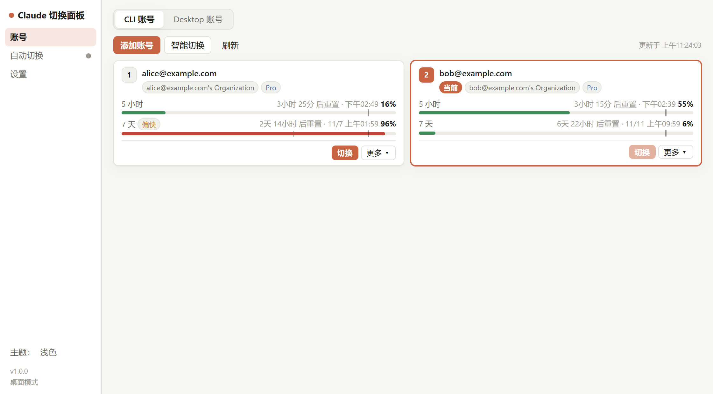
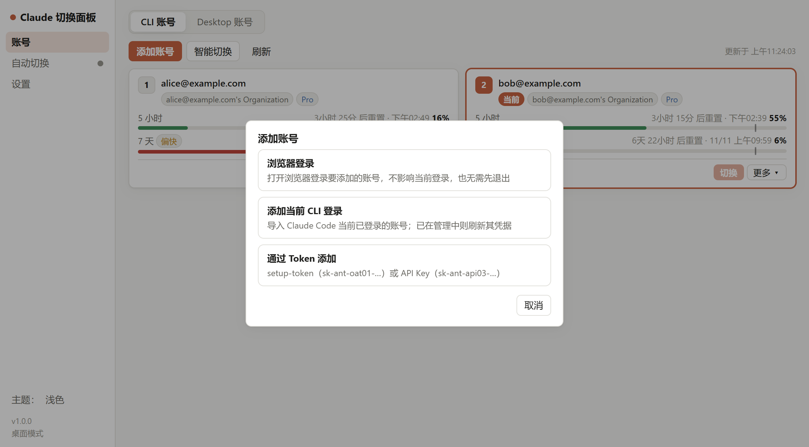
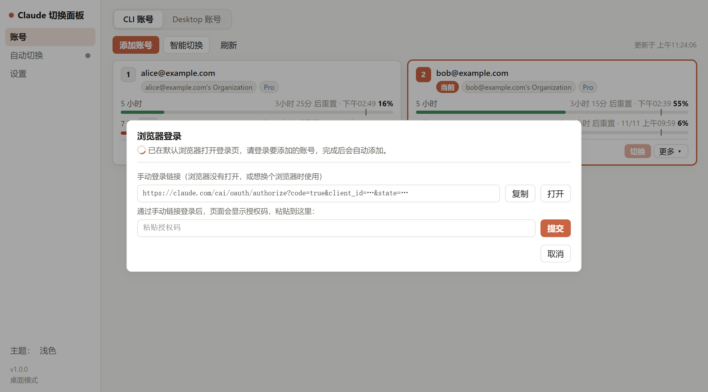
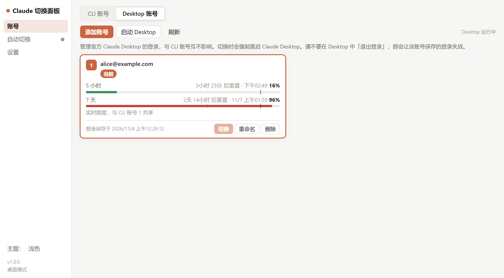
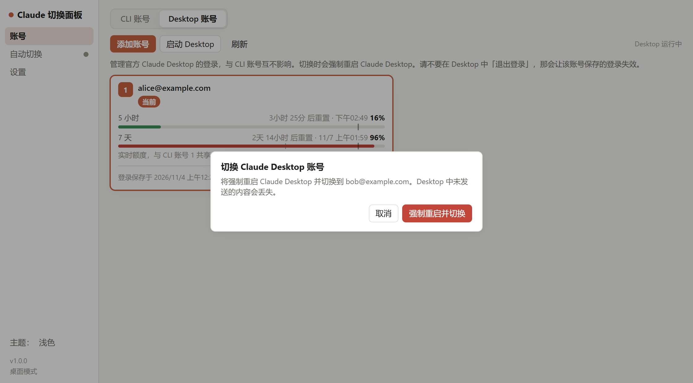
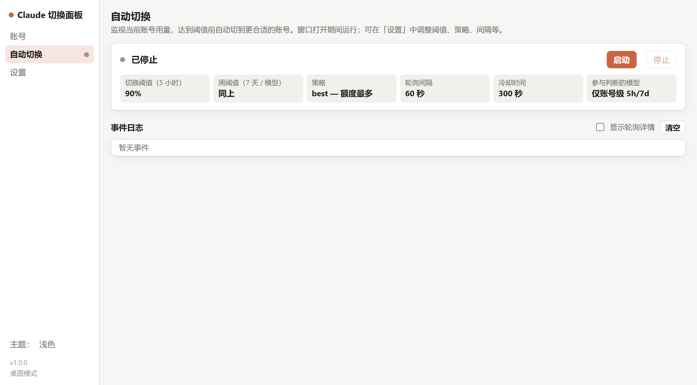
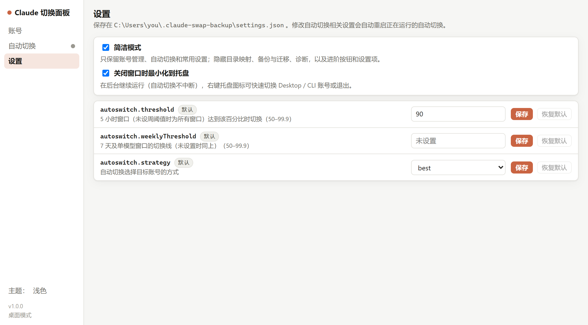
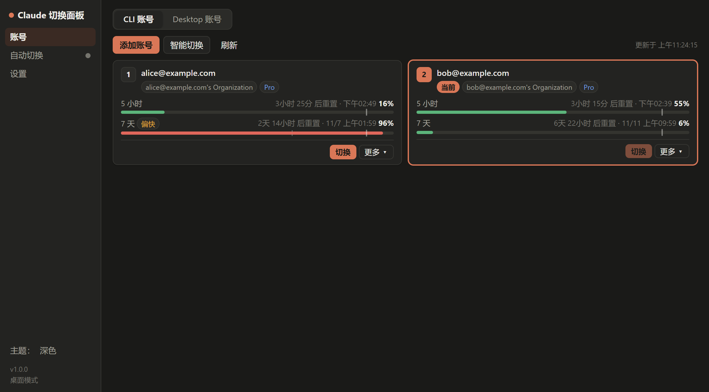

# Claude Switch Panel · Claude 切换面板

Claude Code 与 Claude Desktop 的多账号切换面板：一键切号、额度看板、达到上限前自动切号，常驻托盘随手切换。支持 Windows 与 macOS。

> 本项目是独立的第三方工具，与 Anthropic 无关。



## 功能

### CLI 账号（Claude Code）

每个账号的 5 小时 / 7 天额度一目了然：进度条上较粗的刻度是自动切号阈值，较细的刻度是按时间均匀消耗时应到的位置，用得比时间快时会标「偏快」。一键切换，或点「智能切换」切到剩余额度最多的账号。

添加账号有三种方式：



- **浏览器登录**：全程在软件内完成，自动打开默认浏览器登录要添加的账号，不影响当前登录。浏览器没打开或想换个浏览器时，可以复制手动登录链接，登录后把页面上的授权码粘贴回来。

  

- **添加当前 CLI 登录**：导入 Claude Code 当前已登录的账号。
- **通过 Token 添加**：setup-token（`sk-ant-oat01-…`）或 API Key（`sk-ant-api03-…`）。

### Claude Desktop 账号

在「账号」页顶部切到 **Desktop 账号**，管理官方 Claude Desktop 的登录，与 CLI 账号完全独立、互不影响。



- **添加**：浏览器登录（Desktop 以未登录状态重启，在 Desktop 中登录新账号，当前账号的登录会先保存），或导入 Desktop 当前登录。
- **切换**：会先提示并强制重启 Claude Desktop，只替换登录，不动设置与 Cowork 等数据。

  

- **额度**：额度按账号共享、与客户端无关。同一账号也是 CLI 账号时显示实时额度；否则显示 Desktop 最近一次记录的额度，并提示可添加为 CLI 账号以获取实时数据。

### 自动切号

监视当前账号用量，达到阈值前自动切到更合适的账号；支持演练模式（只记录不切换）与事件日志。



### 托盘

关闭窗口后在后台继续运行（自动切号不中断），再次打开程序会唤出已有窗口。右键托盘图标即可快速切换或退出，每个账号后面附带额度：

```
Desktop：alice@example.com  ·  5h 16% / 7天 96%      ▸ 各 Desktop 账号
CLI：2. bob@example.com  ·  5h 55% / 7天 6%          ▸ 各 CLI 账号 + 智能切换
─────────
打开主窗口
退出
```

### 简洁模式与设置

简洁模式默认开启，只保留账号管理、自动切号和常用设置；关闭后可使用目录映射、会话模式、导入导出、诊断等高级功能。支持浅色 / 深色主题。





### 命令行

同一程序也提供 `cswap` 命令（`cswap status`、`cswap switch`、`cswap list` 等），与界面共享同一份账号数据。

## 下载安装

在 [Releases](https://github.com/xutianhao6/claude-switch-panel/releases) 下载：

| 系统 | 文件 |
|---|---|
| Windows 10/11 (x64) | `*-windows-x64-setup.exe`（安装版，推荐）或 `*-portable.zip`（解压即用） |
| macOS (Apple 芯片) | `*-macos-arm64.dmg` |
| macOS (Intel) | `*-macos-x64.dmg` |

- 界面使用系统自带的 WebView（Windows WebView2 / macOS WKWebView），Windows 安装包约 10 MB。
- **macOS 首次打开**：应用未经公证，请在「应用程序」中右键 Claude Switch Panel →「打开」，或执行
  `xattr -dr com.apple.quarantine "/Applications/Claude Switch Panel.app"`。
- **命令行**：Windows 安装时勾选「将 cswap 命令加入 PATH」即可在终端使用 `cswap`；macOS 使用
  `"/Applications/Claude Switch Panel.app/Contents/MacOS/claude-switch-panel" <命令>`。

## 使用提示

- 切换 CLI 账号后，已经打开的 Claude Code 会话需要重新启动才会使用新账号。
- 切换 Desktop 账号只替换登录（令牌、claude.ai Cookie 与站点存储，均保持 Desktop 自己的加密形式），不动设置与 Cowork 等数据。
- **不要在 Claude Desktop 中「退出登录」**：退出会让服务器端会话失效，本软件为该账号保存的登录也随之失效，需要重新登录添加。
- 想看 Desktop 账号的实时额度：把同一账号也添加为 CLI 账号即可（额度按账号共享，与客户端无关）。
- 数据保存在 `~/.claude-swap-backup`（Windows 为 `%USERPROFILE%\.claude-swap-backup`）。

## 从源码运行与打包

需要 [uv](https://docs.astral.sh/uv/) 与 Python 3.12+。

```bash
uv sync --extra gui
uv run --extra gui claude-switch-panel          # 启动界面（加 --browser 改用系统浏览器打开）
uv run --extra gui cswap status                 # 命令行
uv run --extra gui pytest                       # 测试
uv run --extra gui python packaging/build.py    # 本地打包（Windows 加 --installer 生成安装器，需要 Inno Setup 6）
```

发布：推送 `v*` 标签（如 `git tag v1.0.0 && git push origin v1.0.0`），GitHub Actions 会构建 Windows x64、macOS arm64 / x64 并发布到 Releases。

## 致谢

本项目基于 [realiti4/claude-swap](https://github.com/realiti4/claude-swap)（作者 Onur Cetinkol 及其贡献者，MIT 许可证）开发：账号切换、用量读取与自动切号的核心逻辑来自该项目，桌面界面、Claude Desktop 账号切换、托盘等为本项目新增。感谢原作者的出色工作。

## 许可证

[MIT](LICENSE)
